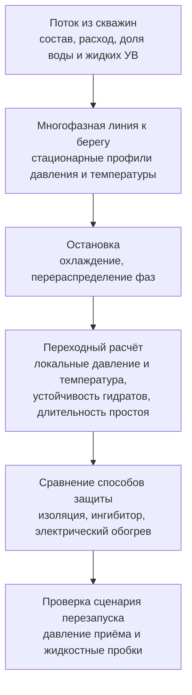
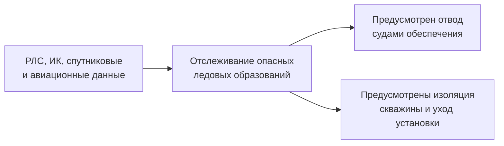

# Инженерные иллюстрации второго этапа

## Готовые материалы

| ID и файл | Источник, оригинальная подпись и права | Как использовать |
|---|---|---|
| [F681 · Обзорная карта групп](F681-kara-sea-field-groups.png) | Авторская карта на береговой основе [Natural Earth 1:50 млн, v5.1.2, общественное достояние](../source_cards/S683.md). Группировка по [S107, с. 141–144 / PDF 1–4](../source_cards/S107.md) и [S417, абз. 1–4](../source_cards/S417.md). | Обозначить два сектора и восемь объектов открытого шельфа. Названия внутри группы не задают порядок по долготе. Положение букв условное, координат скважин и границ залежей на иллюстрации нет. |
| [S682 · West Alpha](S682-West-Alpha-Olen-2014.jpg) | [S682](../source_cards/S682.md). «The semi-submersible rig West Alpha in Ølen, Norway». Frokor, Ølen, Норвегия, 18.07.2014, [CC BY-SA 4.0](https://creativecommons.org/licenses/by-sa/4.0/). Оригинал без правок. | Показать полупогружную установку, которую использовали при бурении Университетской-1. В подписи сохранить место и дату фотографии. Снимок сделан до забуривания в Карском море. |
| [S681a · Август](S681-sea-ice-2014-08.png) и [S681b · Сентябрь 2014 г.](S681-sea-ice-2014-09.png) | [S681](../source_cards/S681.md). «Sea Ice Concentration, Aug 2014» и «Sea Ice Concentration, Sep 2014». Оригинальные карты Sea Ice Index, v4.0, NOAA@NSIDC. Цитировать продукт и месяцы. Кредит «Image courtesy of the National Snow and Ice Data Center, University of Colorado, Boulder». | Показать сезонный фон в месяцы карской кампании. Легенда в процентах описывает сплочённость, розовая линия является медианной кромкой 1981–2010 гг. Среднемесячная сетка 25 км не показывает локального тороса, айсберга или оперативных решений штаба. |
| [S204-F11 · Плотность и глубина борозд](S204-F11-gouge-depth.png) | [S204, печ. с. 31 / PDF 11, рис. 11](../source_cards/S204.md). «The distribution of the density (a) and depth (b) of the ice gouges with sea depth». Ogorodov et al., 2013, [CC BY 4.0](https://creativecommons.org/licenses/by/4.0/). Кадрирована страница с сохранением двух панелей, осей и подписи. | Два максимума приходятся на разные глубины воды, примерно 17 и 19 м в исследованной части Байдарацкой губы. На диаграмме плотность накопленных следов и максимальная глубина следа имеют разные единицы. Сохранность борозд зависит от грунта и волнения, поэтому по одной съёмке нельзя установить частоту событий или требуемое заглубление трубы. См. также [натурную схему следов](S204-F09.png). |

Подписи, читаемость и ориентация файлов визуально проверены. Для F681 использована равнопромежуточная по широте географическая основа с приведением долгот к 75° с. ш. Для карты с отдельными точками под каждый объект потребуются координаты и указание типа геометрии. Скважина открытия, условный центр залежи и полигон лицензии задают разные положения. Если есть только схема лицензирования, точность ограничивается легендой и масштабом её источника.

Воспроизведение F681 в системе с Python и Matplotlib, из корня проекта:

```bash
mkdir -p figures/.check/round2
curl -LfS 'https://raw.githubusercontent.com/nvkelso/natural-earth-vector/v5.1.2/geojson/ne_50m_land.geojson' \
  -o figures/.check/round2/ne_50m_land_512.geojson
MPLCONFIGDIR="$PWD/figures/.check/round2/matplotlib" python3 -B figures/build_field_context.py \
  figures/.check/round2/ne_50m_land_512.geojson figures/F681-kara-sea-field-groups.png
```

## Дополнительные иллюстрации по оригиналам

| Исходник | Оригинальная подпись и точное место | Применение и граница |
|---|---|---|
| [S107, печ. с. 143 / PDF 3, рис. 1](../source_cards/S107.md) | «Геологический разрез и месторождения Приямальского шельфа Карского моря». | Сравнить положение скважин и горизонтов на Русановском, Ленинградском, Динкова, Нярмейском и «75 лет Победы». Оригинал по адресу издателя, права на повторную публикацию изображения не установлены. |
| [S107, печ. с. 144 / PDF 4, рис. 3](../source_cards/S107.md) | «Направление сейсмических профилей». | Уточняет район исходных разрезов. Отдельные площади и линии сейсмики имеют разный смысл. Карта не даёт перечня месторождений с координатами. |
| [S307, с. 19 / PDF 19, второй рис. 2.2](../source_cards/S307.md) | «The geological profile of Leningradskoe field [16]». | Профиль Ленинградского по цитируемому источнику автора. На с. 18 самостоятельная карта с тем же номером. Ссылаться с номером страницы. Для свободно распространяемого регионального фона есть [S103-F01](S103-F01-profile.png). |
| [S307, с. 57–58 / PDF 57–58, рис. 6.14 и 6.15](../source_cards/S307.md) | «Pressure destribution profile» и «Temperature distribution profile». | Учебная проработка установившегося потока для условной 150-километровой линии. Графики не подтверждают поведение при остановке или пределы безопасного перезапуска. |
| [S307, с. 67–68 / PDF 67–68, рис. 7.1 и 7.2](../source_cards/S307.md) | «A cross section scheme of a subsea concept» и «The principle of subsea production system [69]». | Иллюстрации цитируемых автором концепции и общего принципа. При сравнении вариантов полезнее собственная функциональная схема со ссылками. Права на распространение оригинальных рисунков не установлены. |
| [S642, страница с отчётом от 29.09.2014](../source_cards/S642.md) | «West Alpha semisubmersible». | Фото установки в статье о завершившейся карской кампании. Из подписи нельзя установить время и место съёмки. Права на повторную публикацию не установлены. |
| [S640, абзац и карта «Map of the Snøhvit field showing Hammerfest in Northern Norway»](../source_cards/S640.md) | Операторская обзорная карта Snøhvit и Хаммерфеста. | Географически привязать морской сбор и береговую подготовку. Для повторного использования со строгой атрибуцией доступна [авторская функциональная схема](TECHNOLOGY_FIGURES.md). Утверждение о лицензии на операторскую карту не сделано. |

## F682. Почему стационарный тепловой профиль не решает холодный перезапуск

Авторская схема вопросов для сравнения вариантов. Для природных и технологических чисел использовать первоисточники, а стрелки читать как этапы проверки. Основание для обсуждения установившегося потока и кандидатов защиты — [S307, § 6.2.3, с. 55–59, и § 6.2.5, с. 61–63](../source_cards/S307.md). В схеме отдельно показан переходный режим как задание для расчёта.



При адаптации для слайда добавить отдельную подпись к давлению и температуре. Лабораторный состав флюида, количество свободной воды, рельеф трассы и ограничения береговой приёмки нужны для расчёта, поэтому на схеме отсутствуют пороги остановки, режимы дозирования и температуры включения.

## F683. West Alpha и переход от ледовых наблюдений к решению

Авторский сценарный рисунок по заявленным средствам контроля и вариантам реагирования. Исторические даты брать из [S641, приложение 2, Operations](../source_cards/S641.md). Состав средств и заявленные ветви — [S312, абз. «The rig is equipped…» и «To make sure West Alpha…»](../source_cards/S312.md).



Под схемой в реферате уместно сопоставить дату забуривания 9 августа и объявление о начале работ 11 августа. Документы описывают подготовку и предусмотренные процедуры. Применение отдельных аварийных ветвей или изменение работ из-за конкретного ледового образования открытыми материалами не установлено.
