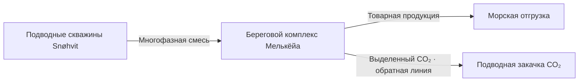

# Технологические схемы и маршруты

## F301. Функциональная схема Snøhvit

Авторская схема по [S310, Development и Transport](../source_cards/S310.md) и [S640, блок о месторождении](../source_cards/S640.md). Баренцево море. Изображены связи, описанные операторским справочником. Размеры символов и расстояния на схеме условные.

Длина основной связи опубликована как 160 км в S310 и 143 км в S640. Около 195 км в S640 относится к суммарному пути от Askeladd Vest. На схеме показана функция связи.

Применение — объяснить, как на реальном арктическом объекте разделены морская добыча, береговая подготовка и обращение с CO₂. В подписи обязательно назвать Баренцево море. Технология закачки CO₂ относится к этому аналогу и сама по себе не обосновывает такую схему на карских месторождениях.

## F302–F304. Иллюстрации для изучения в оригинале

| ID | Источник и исходный номер | Содержание и применение |
|---|---|---|
| F302 | [S307](../source_cards/S307.md), с. 45, рис. 6.1 | Концептуальная трасса от Ленинградского месторождения к району Харасавэя. Сопоставить расстояние до линии берега и до потенциального узла. |
| F303 | [S309](../source_cards/S309.md), с. 91, рис. 45 | Авторская компоновка маршрутов от Победы и Штокмана к Новой Земле. Уместна при разборе альтернатив береговой привязки. |
| F304 | [S308](../source_cards/S308.md), с. 58, рис. 5.6 | Профиль дна в расчётном примере Штокман — Териберка. В методической части иллюстрирует роль рельефа, длины и глубины трассы. |

Изображения из магистерских работ оставлены в исходных документах по ссылкам карточек. Перед воспроизведением требуется проверить условия использования.
